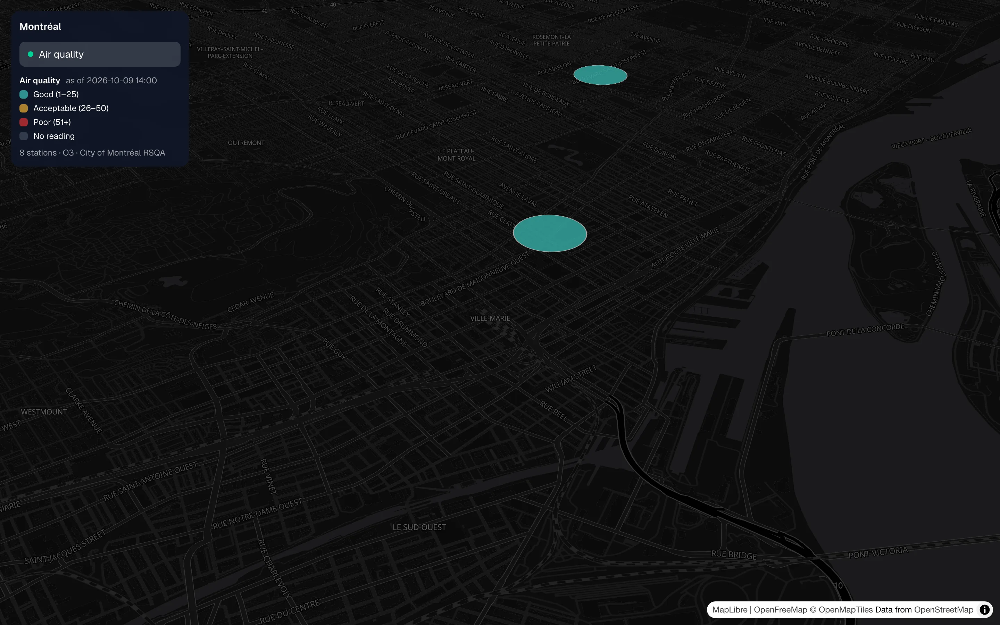
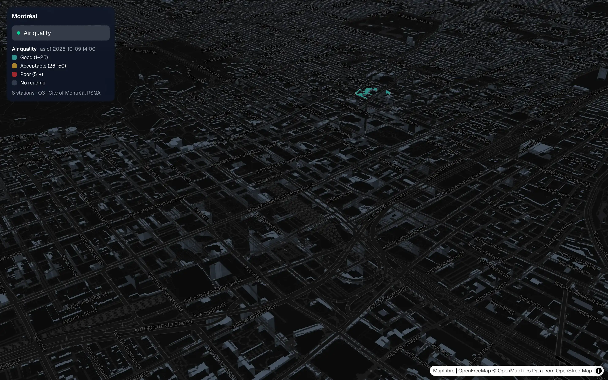

# MyCityVisualization

A multi-layer city data map. deck.gl layers render over a dark MapLibre basemap with 3D building extrusions. One city so far (Montréal) and one data layer (air quality, from the City of Montréal RSQA monitoring network).



**Live:** https://mycity-pied.vercel.app

## Screenshots



Zoomed in and tilted, the app's own building extrusion layer shows up beside a station marker.

## What it does

- Shows RSQA air quality index readings per station, colored Good (1-25), Acceptable (26-50), Poor (51+) or No reading.
- Fetches readings through `app/api/layers/air/route.ts`, which normalises the upstream CSV, revalidates every 300 s and serves the last good payload marked stale if upstream fails.
- Keeps map state in the URL, so a view is shareable by link: `?layers=air&at=<lat>,<lng>,<zoom>,<pitch>,<bearing>`.
- Layers are manifests registered in `src/layers/registry.ts`, the only file that imports a specific layer. Layers never import each other.

## Stack

Next.js 16.3.0 (App Router), React 19.2.8, TypeScript, Tailwind CSS 4, deck.gl 9, MapLibre GL 5, PapaParse. Tests: Vitest (unit) and Playwright (E2E on Chromium and WebKit). Basemap: OpenFreeMap dark style, no API key.

## Run locally

```bash
npm install
npm run dev      # next dev --turbopack
npm run lint
npm test         # vitest run
npm run e2e      # playwright, dev server on port 3123
npm run build && npm start
```

No environment variables are needed.

## Layout

```
app/            Next.js route (page) and /api/layers/air
src/layers/     registry + per-layer folders (air/ is the reference)
src/map/        MapCanvas, basemap config and building extrusion
src/shell/      Shell, LayerToggles, URL state
src/cities/     CityConfig per city (montreal.ts)
e2e/            Playwright specs
fixtures/       CSV test data
scripts/pipeline/  Python pipeline that converts Montréal 3D building data (CityGML) to glb tiles
public/tiles/   generated building tiles
docs/superpowers/  design specs and build plans
```

Architecture notes for contributors are in `AGENTS.md`.
